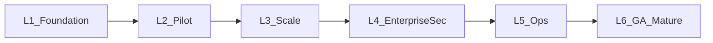

# Production Maturity Roadmap

**Status:** Draft  
**Baseline:** Phases 1–3 complete as a **working foundation** (dev/pilot quality), not production-ready.  
**Goal:** Reach **100% production maturity** — enterprise-deployable, secure, observable, and operationally reliable.

**Rule:** Each phase = dedicated branch + PR + unit/API tests (same delivery standard as Phases 1–3).

---

## Maturity model

| Level | Meaning | Current |
|-------|---------|---------|
| L0 Docs / design | Vision & architecture | Done |
| L1 Foundation | Core APIs/UI, stub AI, fixture connectors | **Done (Phases 1–3)** |
| L2 Pilot-ready | Real auth + 1–2 live connectors + grounded LLM | Phase 4 |
| L3 Scale-ready | Async pipelines, hybrid search quality, multi-tenant | Phase 5 |
| L4 Enterprise-secure | SSO/ABAC, audit, retention, private LLM path | Phase 6 |
| L5 Ops-ready | K8s, SLOs, on-call, DR, CI/CD promotion | **Done (Phase 7)** |
| L6 Production mature | Certified controls, GA SLAs, continuous eval | **Done (Phase 8 = 100%)** |

---

## Already complete (do not re-scope)

| Phase | Branch | Outcome |
|-------|--------|---------|
| 1 Foundation | `phase-1-foundation` | Auth, ingest, search/chat stubs, graph, RBAC, tests |
| 2 Knowledge layer | `phase-2-enterprise-intelligence` | Connector framework, timeline, expertise, hybrid search |
| 3 AI OS | `phase-3-ai-operating-system` | Predictions/workflows/deps/research/exec dashboard (heuristics) |

**Gap vs production:** fixtures ≠ live OAuth; hash/stub LLM ≠ production RAG; heuristics ≠ trained models; Compose/Neon ≠ hardened multi-env platform.

---

## Phase 4 — Pilot Hardening

**Branch:** `phase-4-pilot-hardening`  
**Goal:** First real customer pilot can run safely on a single tenant.  
**Duration (indicative):** 4–6 weeks

### Deliverables

1. **Merge & baseline**
   - Merge Phases 1→2→3 to `main` in order; tag `v0.4.0-pilot`
2. **Real authentication**
   - Production IdP (Clerk **or** Keycloak); retire `AUTH_PROVIDER=dev` outside local
   - Session hardening, refresh, invite flows
3. **Production LLM + embeddings path**
   - Required `LLM_API_KEY` / Azure OpenAI / compatible gateway
   - Sentence-transformers or managed embeddings with versioned collections
   - Answer faithfulness checks; refuse-without-evidence enforced in eval suite
4. **First live connectors (pick 2)**
   - Recommended: **Slack + GitHub** (or Jira + Google Drive)
   - Real OAuth, incremental cursors, webhook signatures, rate-limit backoff
5. **Ingest reliability**
   - Redis/worker queue (move off sync-in-request)
   - Dead-letter + admin retry UI
6. **Pilot UX polish**
   - Error states, empty states, connector health page
7. **Test bar**
   - Contract tests for OAuth connectors (recorded fixtures)
   - RAG gold-set (N≥50 queries) with recall@5 / citation presence gates in CI

### Exit criteria

- [ ] One pilot tenant on SSO  
- [ ] ≥2 live connectors syncing daily without manual fixtures  
- [ ] Chat answers cite only ACL-visible sources on gold set ≥ target  
- [ ] Ingest P95 job completion within agreed SLA for pilot corpus  

---

## Phase 5 — Scale & Knowledge Quality

**Branch:** `phase-5-scale-quality`  
**Goal:** Platform handles real enterprise volume and retrieval quality.  
**Duration:** 6–8 weeks

### Deliverables

1. **Remaining Phase-2 connectors (live)**
   - Teams, Jira, Drive, Outlook, Gmail (complete the priority set)
2. **Async architecture**
   - Kafka (or managed equivalent) for high-volume events  
   - Horizontal ingest workers; backpressure metrics
3. **Hybrid retrieval v2**
   - Keyword index (Postgres FTS or OpenSearch)  
   - Graph expansion (bounded hops) in retrieval planner  
   - Reranker (cross-encoder or LLM rerank) optional
4. **Entity resolution**
   - People/project merge, duplicate detection, `Supersedes` audit trail
5. **Decision / Project memory depth**
   - Auto-link from PRs/issues/meetings with confidence thresholds + human confirm
6. **Multi-tenancy**
   - Hard `tenant_id` isolation across Postgres, Neo4j, Qdrant, object store  
   - Per-tenant encryption keys (at least envelope encryption design)
7. **Test bar**
   - Load test: search/chat P95 targets  
   - Tenant isolation regression suite (must be red-team tested)

### Exit criteria

- [ ] All priority connectors live  
- [ ] 10× pilot corpus without manual intervention  
- [ ] Search success rate meets product KPI on expanded gold set  
- [ ] Zero cross-tenant leakage in isolation tests  

---

## Phase 6 — Enterprise Security & Compliance

**Branch:** `phase-6-enterprise-security`  
**Goal:** Security posture acceptable for regulated / large-enterprise buyers.  
**Duration:** 6–8 weeks

### Deliverables

1. **SSO enterprise**
   - SAML + OIDC; SCIM user provisioning (or documented equivalent)
2. **ABAC**
   - Attribute policies on classification, project membership, region  
   - Retrieval-time enforcement (already required) + UI explanation when blocked
3. **Audit & retention**
   - Immutable audit log export  
   - Retention jobs + legal hold  
   - DSR/export/delete cascading to graph + vectors + objects
4. **Secrets & crypto**
   - Vault/cloud KMS; rotate connector tokens  
   - TLS everywhere; encryption at rest verified
5. **Private / local LLM path**
   - Config switch for air-gapped or VPC model endpoints  
   - No training on customer data by default (contractual + technical controls)
6. **AppSec**
   - Dependency scanning, container scan, SAST in CI  
   - Prompt-injection test suite against retrieved docs
7. **Test bar**
   - Security regression pack; ABAC matrix tests; retention cascade tests

### Exit criteria

- [ ] SSO + SCIM working with a real IdP  
- [ ] ABAC policies enforceable on search/chat  
- [ ] Retention/delete proven end-to-end  
- [ ] Security review checklist signed off (internal or external)

---

## Phase 7 — Platform Operations & Deployability

**Branch:** `phase-7-platform-ops`  
**Goal:** Run like a production SaaS / single-tenant cloud product.  
**Duration:** 6–8 weeks

### Deliverables

1. **Environments**
   - `dev` / `staging` / `prod` with Terraform (or equivalent IaC)  
   - GitHub Actions → ArgoCD (or cloud CD) promotion path
2. **Kubernetes packaging**
   - Helm/Kustomize charts for API, workers, web  
   - HPA for API/workers; PDB; resource requests/limits
3. **Observability**
   - OpenTelemetry traces; Prometheus metrics; Grafana dashboards  
   - Golden signals + domain metrics (ingest lag, grounded ratio, ACL drop rate)  
   - Alerting + on-call runbooks validated with game days
4. **Reliability**
   - Backups/PITR for Postgres; Neo4j/Qdrant snapshot drills  
   - Documented RPO/RTO; chaos/failover test once
5. **Cost controls**
   - LLM budget quotas per tenant; caching; model routing by task
6. **Deployment options matrix**
   - SaaS multi-tenant, single-tenant cloud, private VPC documented & tested at least once each
7. **Test bar**
   - Smoke E2E in staging on every release  
   - Backup restore drill recorded

### Exit criteria

- [ ] Staging≈prod parity  
- [ ] SLO dashboards live; pages for error/latency budgets  
- [ ] Successful restore drill  
- [ ] One single-tenant deploy proven  

---

## Phase 8 — GA / Production Maturity (100%)

**Branch:** `phase-8-ga-maturity`  
**Goal:** Generally available product meeting enterprise “production mature” bar.  
**Duration:** 6–10 weeks

### Deliverables

1. **ML maturity (replace heuristics where it matters)**
   - Calibrated risk models (delay, knowledge loss, overload) with offline eval  
   - Expert ranking trained/evaluated on labeled feedback  
   - Forecasting with backtesting reports
2. **Agent maturity**
   - LangGraph (or equivalent) research/ops agents with tool allowlists  
   - Human-in-the-loop approvals for write/automation actions  
   - Agent eval harness (task success, citation fidelity, unsafe-action rate)
3. **Automation engine**
   - Policy-gated actions: notify, create ticket, update doc draft  
   - RPA/webhook integrations for top 3 automation patterns
4. **Executive productization**
   - KPI definitions locked; trend history; exportable board packs  
   - Role-based executive vs operator views
5. **Quality & GA process**
   - Continuous RAG/agent evals in CI  
   - Support playbooks, status page, versioned changelogs  
   - Performance budgets enforced (search/chat P95)
6. **Compliance packaging**
   - SOC2-oriented control evidence pack (even if certification timing is external)  
   - GDPR DPA templates + data map  
   - Penetration test remediation closed
7. **Commercial readiness**
   - Admin billing/quotas (if SaaS)  
   - SLA definitions; uptime commitment measured  

### Exit criteria = **100% production maturity**

- [ ] GA tag `v1.0.0`  
- [ ] All priority connectors + SSO/ABAC + private LLM path in prod config  
- [ ] SLOs met for ≥1 full release cycle in staging/prod  
- [ ] Pen-test / security review findings closed or accepted with owners  
- [ ] Continuous eval gates green on main  
- [ ] Runbooks + on-call proven; backup/restore proven  
- [ ] Customer pilot(s) converted or formally accepted as production use  

---

## Suggested sequencing & branches

| Phase | Branch | Depends on |
|-------|--------|------------|
| 4 Pilot hardening | `phase-4-pilot-hardening` | Merge 1–3 to main |
| 5 Scale & quality | `phase-5-scale-quality` | Phase 4 exit |
| 6 Enterprise security | `phase-6-enterprise-security` | Phase 5 exit (can overlap late Phase 5) |
| 7 Platform ops | `phase-7-platform-ops` | Phase 6 controls baseline |
| 8 GA maturity | `phase-8-ga-maturity` | Phase 7 exit |

**Parallelization note:** Phase 6 security can start once Phase 4 SSO lands; Phase 7 IaC can start in parallel with late Phase 5 if staffing allows — but **exit criteria remain sequential** for “maturity level” claims.

---

## Definition of Done (every phase)

1. Feature code + migrations  
2. Unit + API tests (CI green without live customer secrets)  
3. Integration tests behind `@pytest.mark.integration` / staging secrets  
4. Docs updated (`mvp`/`phases`/runbooks as needed)  
5. Branch PR with Summary + Test plan  
6. Explicit exit-criteria checklist checked in the phase PR description  

---

## Non-goals until after Phase 8

- Building every connector in the long catalog (SAP/Oracle/etc.) before GA  
- Claiming SOC2 certification before evidence + audit engagement  
- Replacing Neo4j/Qdrant mid-flight without adapter stability (keep adapters)

---

## Immediate next action

1. Tag `v1.0.0` after Phase 8 merge  
2. Run continuous eval gates on `main`  
3. Schedule external SOC2 / pen-test engagement using the in-product evidence pack  

Related: [phases.md](phases.md) · [phase-8-plan.md](phase-8-plan.md) · [phase-8-pr.md](phase-8-pr.md)
